# Installable learning app and offline lessons

plsteach.me can be installed on a laptop as a Progressive Web App. It is the same Next.js app and the same deployment as the website: no Electron, Tauri or second frontend. The installed app opens straight into `/learn` in its own window, with its own icon, and uses the same accounts, progress and AI coaching. The nine built-in illustrated lessons can be downloaded for offline practice.

| Online catalog with install action | Download states on catalog cards |
| --- | --- |
| 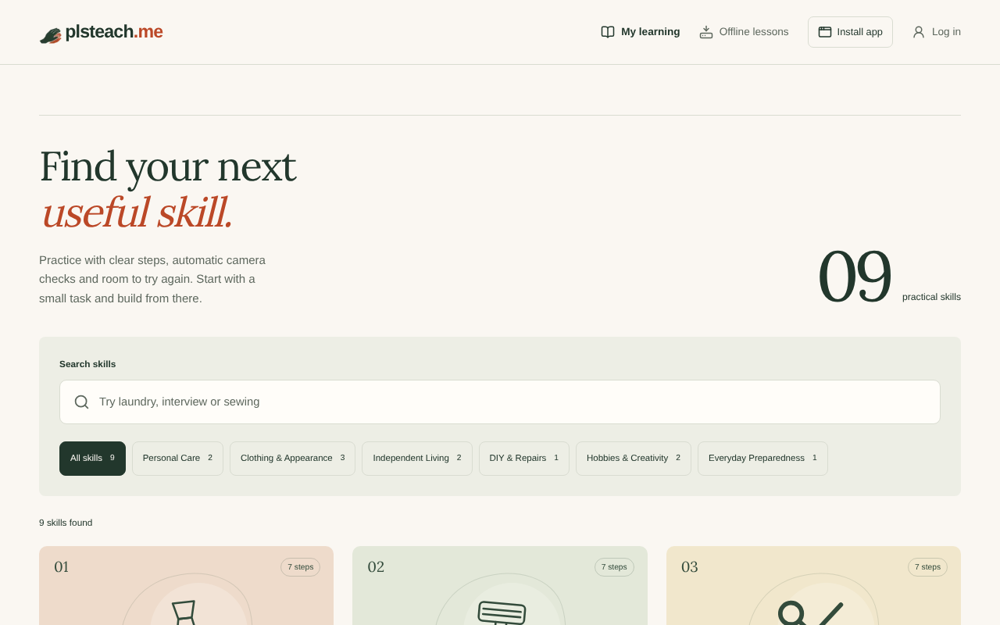 | 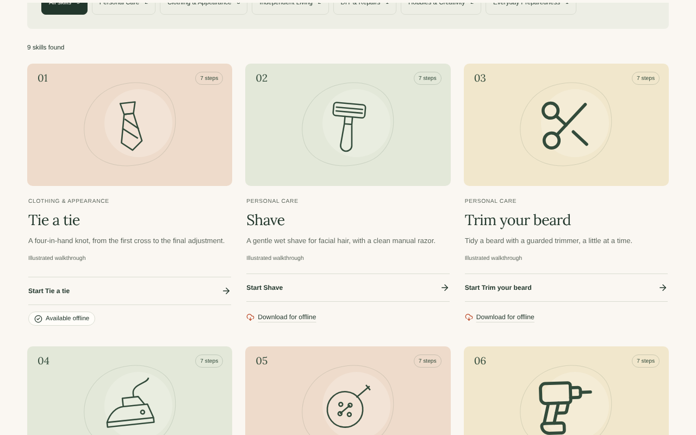 |

## What changed

| Area | Files |
| --- | --- |
| Manifest, icons, version | `app/manifest.ts`, `lib/pwa/config.ts`, `public/icons/*` (from `scripts/generate-icons.mjs`), `app/api/version/route.ts`, `next.config.ts` |
| Service worker and registration | `public/sw.js`, `components/pwa.tsx` (one registration for `/`; the old `/coach/` one is removed) |
| Install action | `lib/pwa/install.ts`, `components/install-app.tsx`, `components/app-download.tsx` (website footer band) |
| Offline packages | `lib/offline/packages.ts` (storage), `lib/offline/store.ts` (UI state), `components/offline-lesson.tsx` |
| Offline library (offline shell) | `app/[locale]/learn/offline/page.tsx`, `components/offline-library.tsx` |
| Connectivity and notices | `lib/offline/connectivity.ts`, `components/app-status.tsx`, `lib/network.ts` |
| AI stays online | `components/learner-trial.tsx`, `components/camera-coach.tsx`, `components/lesson-questions.tsx` |
| Progress after reconnecting | `components/utilities.tsx`, `components/lesson-player.tsx` |
| Data deletion | `lib/storage/store.ts` (`deleteMyData`), `components/account-panel.tsx` |
| Styles | `app/offline.css` (existing tokens only) |

## Manifest

- `id: /learn` is the stable app identity. The old manifest had no id and started at `/coach`; that identity is not reused, so any old `/coach` install stays a separate app.
- `start_url: /learn`, `display: standalone`, name and short name `plsteach.me`, cream background `#faf7f2`, green theme `#22372c`.
- Icons are the existing hands logo on the cream background: 192 and 512 px regular icons (rounded tile), a full-bleed 512 px maskable icon with the logo in the safe zone, and a 180 px `apple-touch-icon` for Safari's Add to Dock.
- **Scope is `/`.** Sign-in, email confirmation, password reset and `/account` therefore stay in the app window instead of opening an out-of-scope bar. The scope only decides which pages open in the window. What may be cached is decided separately by the service worker, below.
- One manifest for the whole site, linked automatically by Next.js from `app/manifest.ts`. The coach layout no longer links it a second time.

## Install action

- **Chrome and Edge:** the `beforeinstallprompt` event is captured as soon as the app loads, which also stops the browser from showing its own banner on every visit. A quiet **Install app** button appears in the learning header only while the browser offers installation, and opens the browser's own prompt. If someone declines, the button stays hidden for 30 days.
- **Safari 17+ on macOS:** the button explains *File › Add to Dock* in a small panel, with **Don't show again**.
- **Already installed** (`display-mode: standalone`): no install action at all.
- **Other browsers** (for example Firefox): no button. The *Offline lessons* page explains that the website keeps working in the browser.
- No download button for an installer file exists, because there is none.

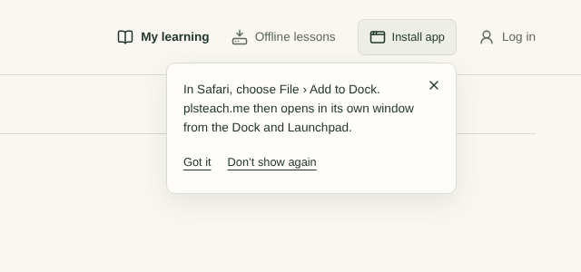

### On the website

The bottom of every public page (just above the footer wordmark) has a *Get the app* band: **Learn on your laptop, even offline.** Its main button does what the visitor's browser can really do: **Install the app** opens the Chrome/Edge install prompt, **Add to Dock** shows the Safari steps, **Open your lessons** appears in the installed app, and other browsers get **Start learning** with a note on where installing works. **Download lessons** links to `/learn/offline`. The orange laptop-carrying companion on the right matches the site's existing mascots and also appears on the offline download library. Its public WebP is included in the offline shell package. The band never appears in the learning environment, and there is no installer file to download.

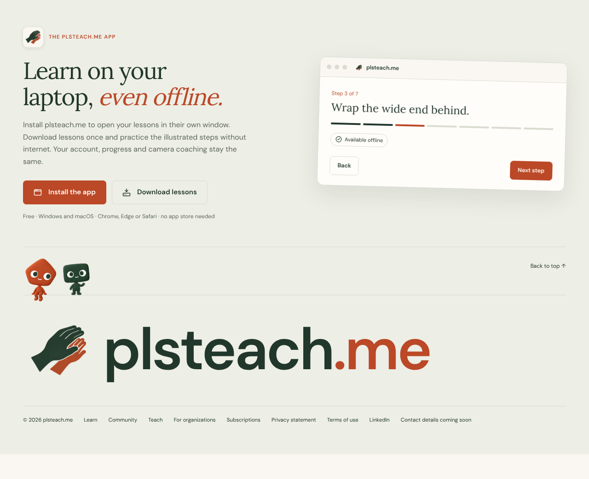

## Offline lessons

**Download for offline** sits on every built-in lesson card and in each lesson's **Prepare** view. **Offline lessons** in the learning header lists everything on the device. States: *Available online*, *Downloading* (with a progress bar and Cancel), *Available offline*, *Update available*, and *Download failed* (with the reason and **Try again**).

| Available online | Downloading | Available offline |
| --- | --- | --- |
| 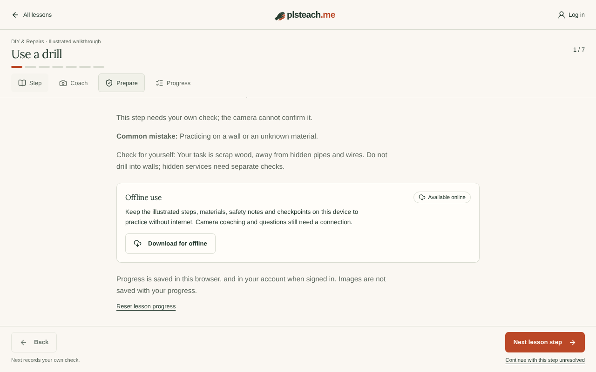 | 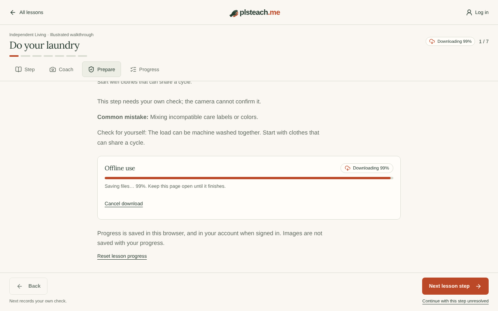 | 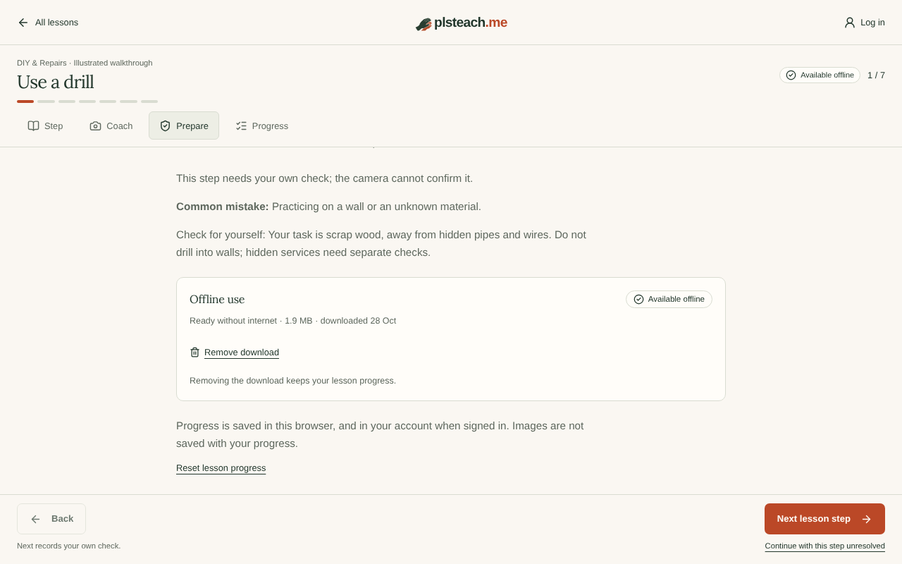 |

| Download failed | Update available |
| --- | --- |
| 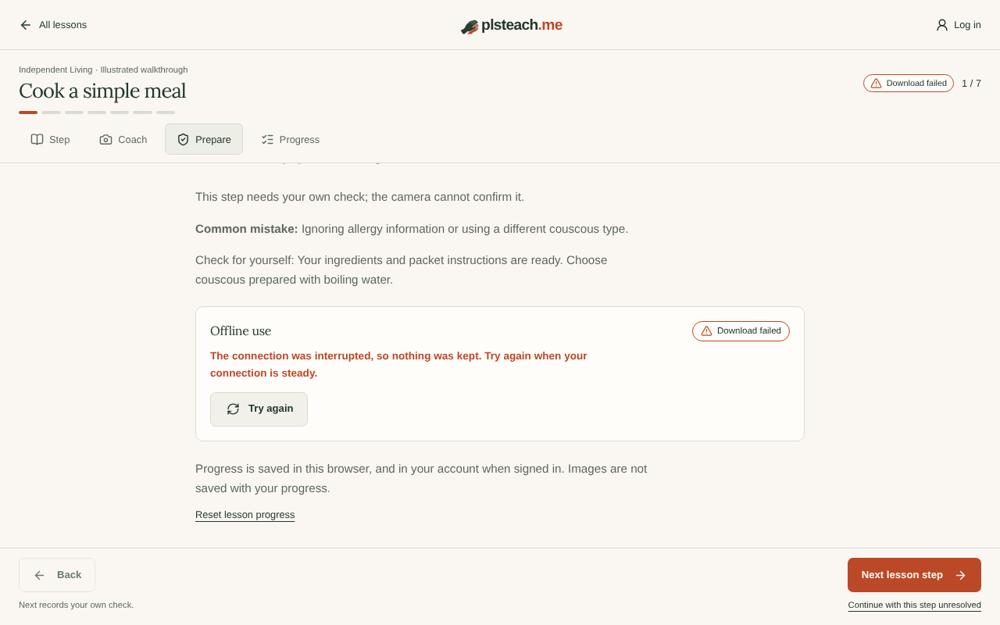 | 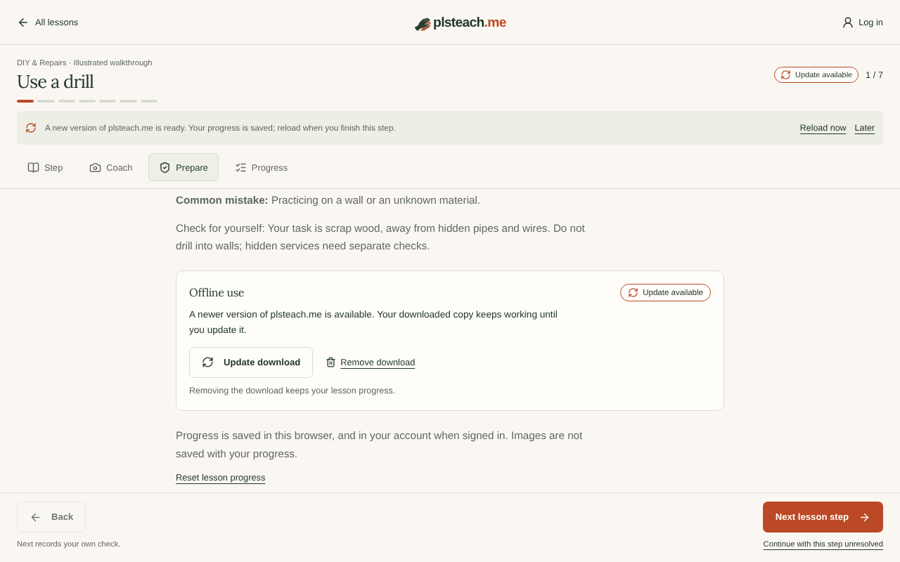 |

A lesson package holds what independent practice needs: the lesson page (instructions, illustrations and animations, materials, safety notes, checkpoints, Back/Next, completion and the checkpoint record), the build files that page uses, the fonts, the logo, the manifest and the icons. That comes to about 2 MB per lesson. Teacher videos, private organization lessons, uploaded manuals, camera models (`/mediapipe`, `/vision`) and other media are never downloaded.

- **Remove download** deletes the package only. **Reset lesson progress** in Prepare is a separate action, and removing a download never touches progress.
- **Not enough storage:** before starting, the browser's storage estimate is checked; a full disk during the download is also caught. Both show a clear message and keep nothing.
- **Interrupted connection:** the partial package is deleted at once and the learner can retry. A package abandoned by a closed window is cleaned up on the next start.
- **Cancel:** the action cancels the entire lesson download, including preparation of the offline library. Concurrent lessons share library preparation; cancelling one does not cancel another. Removing downloads waits for pending writes to stop before clearing storage.
- **Damaged package** (a file was evicted): it is never served. The lesson shows *Download failed* with a repair message, and **Try again** replaces it.
- Account deletion and *Delete my data* also remove all offline packages. The install preference is a `plsteach.*` key, so it is cleared with the rest.

## Offline use

The app starts offline at `/learn`. The service worker sends that request to the offline library, which lists the downloaded lessons with their progress and says which other lessons need a connection. A downloaded lesson opens directly by its own URL (`/learn/tie`). Next.js client-side links fall back to a full navigation when their data request fails, so links never leave a blank page.

| Offline lesson | Coaching while offline | Offline start (`/learn`) |
| --- | --- | --- |
| 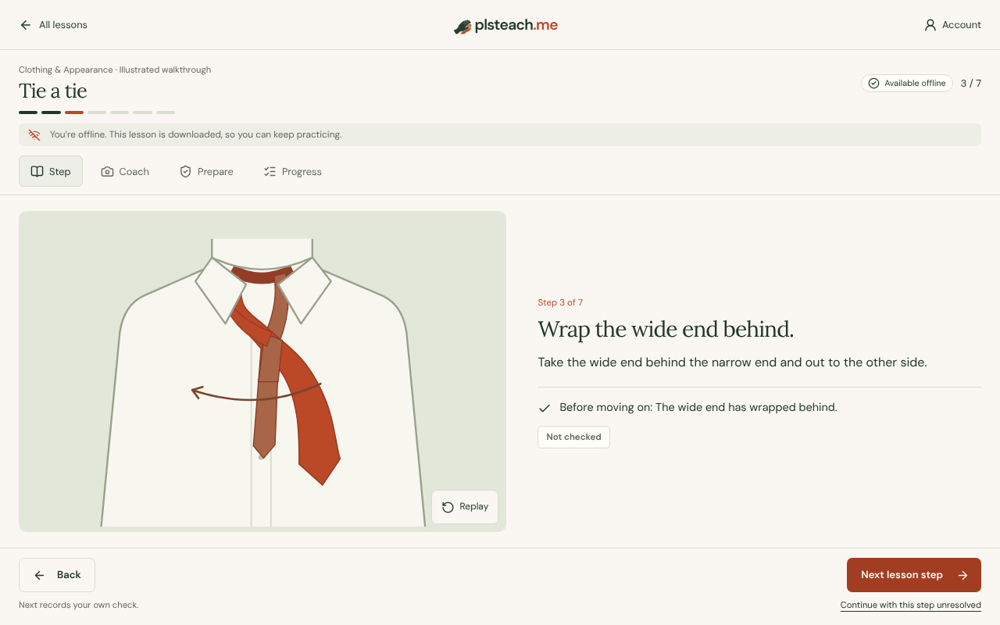 | 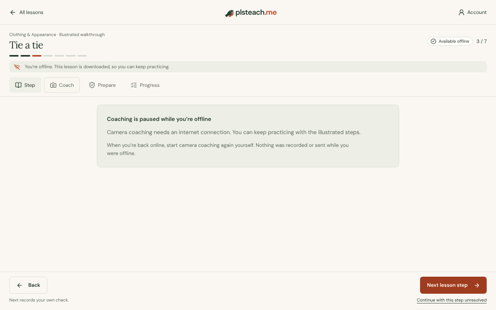 | 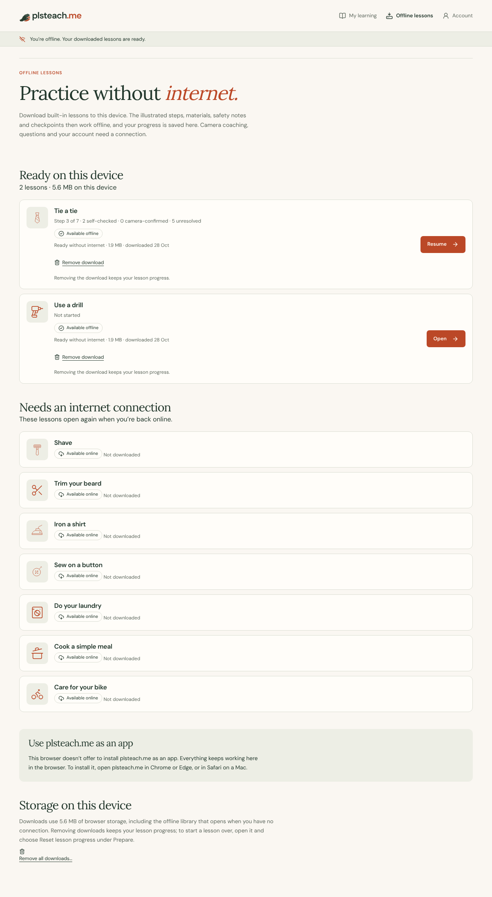 |

| Mobile: offline lesson | Mobile: offline library |
| --- | --- |
| 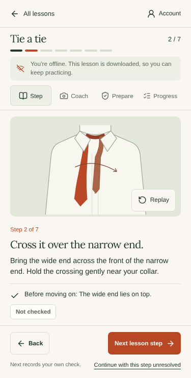 | 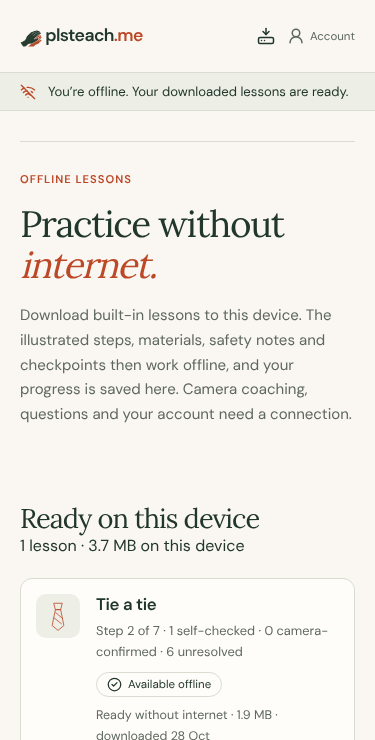 |

**Offline detection** does not trust `navigator.onLine` alone. `lib/offline/connectivity.ts` probes `/api/version`, which carries no user data and is never cached. A network error, a timeout or a 5xx counts as offline (*unreachable*), as does any failed `fetchWithTimeout`. While offline it probes again every 20 seconds and on `online`, `focus` and `visibilitychange`. The notices are calm lines: *You're offline. Your downloaded lessons are ready.* or *plsteach.me can't be reached right now.* Offline, the header shows a neutral *Account* label, which makes no claim that anyone is signed in.

## AI stays online

While offline:

- the free-session panel, camera coach and question form show *Camera coaching needs an internet connection. You can keep practicing with the illustrated steps.*
- no request goes to the coaching, question, report, trial or vision endpoints, so none reaches OpenAI;
- an active camera check stops: its tracks are released, no frame is kept, nothing is queued, and any shown feedback is cleared;
- checkpoints can only be self-checked or left unresolved, never camera-confirmed.

When the connection returns, coaching availability and the account are checked again. The camera never restarts by itself and is not requested again: the learner presses **Start camera coaching**. Consent, the 16+ confirmation, the one free session and organization authorization are unchanged, and downloading never calls the trial or AI endpoints.

## Progress and accounts

Progress keeps its storage key (`plsteach.learning.v1`), lesson ids and checkpoint states (camera-confirmed, self-checked and unresolved stay separate). Offline progress is saved locally on every step, as before. The account sync now stops while offline and starts again when the connection returns. It then merges per lesson by change time, so the newer copy wins both in the browser and on the server (`progress_save` already refuses older copies). An open lesson page now adopts a newer synced copy instead of writing its older state over it later.

Failed progress reads and writes are retried with bounded exponential backoff (5–60 seconds), and immediately on reconnect, window focus or **Retry sync**. Writes are serialized and acknowledged only after an HTTP success, so a failed upload remains pending. Retrying never changes the original edit timestamp. A visible notice explains that account synchronization failed. Leaving the page or going offline cancels pending requests and retry timers. The account navigation rechecks the session and profile after reconnecting so the username returns without a reload.

On short screens, lesson pages use a compact offline notice while retaining the full explanation for screen readers. At 320 × 568, the artwork sits above full-width instructions so the checkpoint and navigation remain visible. The layout regression covers all 63 built-in steps at 320 × 568, 375 × 667 and 844 × 390, without hiding or truncating instructions.

Authentication stays online-only. `/api/*` and `/auth/*` are never intercepted by the service worker, account pages are never cached, and no token is stored. Confirmation and recovery links opened in the installed app go straight to the existing server routes. Offline, sign-in and account pages show the offline library with *Your account, sign-in and password links need an internet connection.*

## Service worker and caching strategy

`public/sw.js` never writes to a cache. Packages are written by the page, only when a learner chooses to download.

| Request | Handling |
| --- | --- |
| `/api/*`, `/auth/*`, non-GET, other origins | Not intercepted |
| React Server Component requests (`RSC` header or `_rsc`) | Not intercepted, never cached |
| Page navigations | Network first (with navigation preload). If the network fails, hangs for 8 s or answers 5xx: a complete package for that exact page, otherwise a redirect to the offline library (`/learn/offline?from=…`), otherwise the browser's normal error |
| `/_next/static/*`, `/icons/*`, `/brand/*`, `/fonts/*`, `/manifest.webmanifest`, `/mascots/download-companion.webp`, `/_next/image` of the logo | From a complete package if it has the file, otherwise the network |
| Anything else (profile photos, signed storage and video URLs, `/mediapipe`, `/vision`) | Not intercepted |

**Packages** live in CacheStorage, one cache per lesson: `plsteach-offline:lesson:<skill>:<version>:<started>`, plus `plsteach-offline:shell:…` for the offline library.

- The page is fetched with `credentials: 'omit'` and `redirect: 'error'`, so it is the anonymous public page and cannot contain account data. The offline library is a static page with no account data by construction.
- Build files are found by reading the page's HTML and stylesheets. The page's own headers, including the Content-Security-Policy, are stored with it.
- A package counts only when its marker is written, which happens after every file. The service worker also checks that every listed file is present.
- Packages are self-contained, so old HTML always finds its own JavaScript. A replacement is complete before the previous copy is deleted.

**Versions.** Each build gets a version (`<commit>-<build time>`). It goes into every page (`<meta name="plsteach-version">`), into `/api/version` and into each package.

## App updates

- A new deploy is noticed through `/api/version`: on start, when the learner returns to the window (at most every 5 minutes), and after reconnecting. A quiet line says *A new version of plsteach.me is ready. Your progress is saved; reload when you finish this step.*, with **Reload now** and **Later**.
- The app never reloads by itself. While camera coaching runs, Reload is disabled with *Stop camera coaching first.* Progress is written on every step, so nothing is lost on reload.
- Online navigations always get fresh HTML, so new pages never meet old JavaScript. Downloaded lessons show *Update available*. The old copy keeps working offline until **Update download** has stored the new one.
- The offline library is refreshed in the background after a deploy (it is small). Lesson packages are only updated when the learner chooses to.
- The service worker keeps no state of its own, so a new `sw.js` activates right away (`skipWaiting`, `clients.claim`) without reloading any page. It is registered with `updateViaCache: 'none'`, and `next.config.ts` sends `no-cache` for it.
- **Recovery:** damaged packages are reported and repaired with *Try again*. *Remove all downloads* on the Offline lessons page clears everything; progress stays.
- **Development:** `next dev` never registers the worker. It unregisters any existing one and removes old packages, and the download controls explain that they work in production builds only.

## Cloudflare / OpenNext

Nothing changed in `wrangler.jsonc` or `open-next.config.ts`. `sw.js` and `public/icons/*` are served as static assets by Workers Static Assets (`Cache-Control: public, max-age=0, must-revalidate`). The manifest, `/api/version` and pages come from the worker. Security headers are not weakened: cached pages keep their CSP, and the service worker needs no new CSP source (`worker-src 'self'` already allowed it). The proxy skips `/sw.js` and `/icons/*`.

## Checking installation manually

Use the deployed HTTPS site; installation needs HTTPS or `localhost`.

**Windows: Chrome or Edge**
1. Open `https://plsteach.me/learn`. In the learning header, select **Install app**. Alternatively use the install icon in the address bar, or in Edge *… › Apps › Install this site as an app*.
2. Confirm. Check that plsteach.me opens in its own window with the hands icon, in the Start menu and on the taskbar, and that it starts at *Find your next useful skill* (`/learn`), not the landing page.
3. Open a lesson, choose **Prepare › Download for offline**, and wait for *Available offline*.
4. Close the app. Turn off Wi‑Fi or enable flight mode. Open plsteach.me from the Start menu: it shows *You're offline. Your downloaded lessons are ready.* Open the lesson, use Back/Next, finish it, close and reopen, and check that progress resumes.
5. Turn Wi‑Fi back on. Sign in if needed, check your name top right, and check that progress appears on another device. Start camera coaching yourself.
6. Uninstall from the app window's *… › Uninstall* menu, or from Windows Settings › Apps.

**macOS: Chrome or Edge.** The same steps. The app appears in Launchpad and `~/Applications/Chrome Apps` (or `Edge Apps`); test offline mode by turning off Wi‑Fi.

**macOS: Safari 17 or later (Sonoma).** Open `/learn`, select **Install app** to see the instructions, then choose *File › Add to Dock*. The app opens in its own window from the Dock. Repeat steps 3–5. Safari keeps the Add to Dock app's storage separate from the Safari browser, so download lessons inside the Dock app.

**Email links.** With the app installed, request a confirmation or password-reset email and open its link. Depending on the OS and browser it opens in the browser or in the app. In both cases it must arrive on the login form, `/learn` or `/reset-password` through the existing `/auth/confirm` and `/auth/callback` routes.

## Verification

Commands, against a production build (offline behavior is not tested with `next dev`):

```sh
npm test                 # unit tests, including service worker routing, packages, connectivity, manifest and icons
npm run typecheck
npm run build && npm start
npm run test:pwa         # 33 real-service-worker browser tests (Chromium)
npm run test:e2e         # existing production browser tests
npm run test:browser     # existing coach tests; needs ENABLE_INTERNAL_TOOLS=true on the server
npm run build:cloudflare # OpenNext build; `npx wrangler dev` then `TEST_BASE_URL=http://localhost:8787 npm run test:pwa`
```

If the pinned Playwright cannot find its browser, set `TEST_BROWSER_PATH` to an installed Chromium; the PWA and coach configs honor it.

**Automatically tested in headless Chromium, with real service workers:**

- the manifest is valid and linked once on the landing page, `/learn`, a lesson, `/login` and `/coach`; start URL and scope; every icon loads with its declared size;
- `/learn` is the learning environment without marketing navigation;
- one root registration replaces an old `/coach/` registration;
- the install button appears only after `beforeinstallprompt`, the browser banner is suppressed, a dismissal is remembered, there is no prompt in standalone mode, Safari shows Add to Dock help and Firefox gets the explanation (user agents and display mode are simulated);
- a full download from the catalog; offline open, Back/Next, Prepare and Progress views, a closed and reopened window, an offline start at `/learn`, resume and finish;
- notices for lessons that are not downloaded and for account pages; a Next.js link falling back offline;
- an interrupted download and its retry, full storage, removal that keeps progress, reset that keeps the download, damaged-package repair, and a new app version that does not reload the page while the old download keeps working;
- CacheStorage holds only allowlisted public files; package HTML is fetched without the session cookie and holds no profile data; the CSP is kept;
- no AI, trial or camera requests while practicing offline; no camera-confirmed checkpoints; nothing queued in storage;
- going offline stops an active camera's tracks, and reconnecting does not restart it or ask for the camera again;
- `/auth/confirm` and `/auth/callback` links bypass the service worker and reach the existing routes;
- the marketing site works with the worker installed and caches nothing; the *Get the app* band uses the real install prompt or Safari instructions, links to no installer file, and does not appear on learning pages;
- the band, the offline library (online and offline), the download controls and the offline lesson notice pass axe WCAG 2 A/AA checks;
- offline progress syncs after reconnecting, and a newer account copy is not overwritten by an older local one.
- failed progress reads/writes recover through the visible retry action, account names return after an offline start, cancelling the first download also cancels preparation, and concurrent lesson downloads remain independent;
- every illustrated step fits the three short-screen viewports above while offline.

The same suite (22 tests at the time; the website band tests were added later) passed against the Cloudflare worker running locally in `wrangler dev` (workerd).

**Existing checks, still passing:** unit and API tests (sign-in and registration, password recovery, profiles, progress sync, organization authorization, data deletion), production e2e tests (login, signup, the username top right, profile editing, camera permission and stopping tracks, training access, the marketing site) and the coach browser tests.

**Checked manually:** not yet. OS-level installation on Windows and macOS (Chrome, Edge, Safari Add to Dock), taskbar and Dock icons, and email links opened while the app is installed have not been tried on real machines. Only headless Chromium on Linux was used. Use the steps above.

## Known limitations

- Safari and Firefox were not tested automatically, only through user-agent simulation for the install UI. Safari gives an Add to Dock app its own storage, separate from the Safari browser.
- Each package carries its own copy of shared build files (about 2 MB per lesson). This keeps every package self-contained and atomic, at the cost of some duplication.
- Browsers may evict CacheStorage under storage pressure. The app asks for persistent storage, which installed apps usually get, and reports a damaged package if files disappear.
- Published teacher lessons, organization training, videos, manuals and on-device vision models remain online-only, as scoped.
- An installed app whose start URL changed (the old `/coach` manifest) is not migrated automatically. It stays a separate app.
